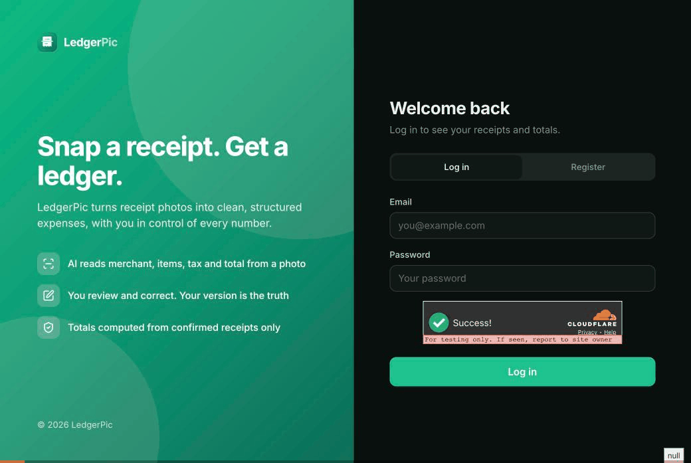

# LedgerPic

Take a photo of a receipt. A vision model reads the merchant, date, currency, line items, tax and total. You review and correct the draft. Confirmed receipts roll up into per-currency spending totals computed by the server.



| | |
|---|---|
| **Live app** | `TODO: https://<your-app>.vercel.app` |
| **Backend** | `TODO: cloud URL, or "local + tunnel" (see below)` |
| **Demo video** | `TODO: link` |
| **Repository** | https://github.com/semirturgay/ledger-pic |
| **Test account** | Sign up on the login page with any email and a password of 8+ characters. |

**Contents:** [Quick start](#quick-start) · [Development](#development) · [Architecture](#architecture) · [How extraction works](#how-extraction-works) · [Data and API](#data-and-api) · [Frontend](#frontend) · [Configuration](#configuration) · [Tests and CI](#tests-and-ci) · [Deploy](#deploy) · [Security](#security) · [Project layout](#project-layout)

## Quick start

One command runs the whole app. You only need Docker.

```bash
cp .env.example .env
# Edit .env:
#   JWT_SECRET=<output of: openssl rand -hex 32>
#   and one model key:
#     GEMINI_API_KEY=...                                (Gemini, the default: https://aistudio.google.com/apikey)
#     or EXTRACTION_PROVIDER=claude and CLAUDE_API_KEY=...  (Claude: https://console.anthropic.com)

docker compose up -d --build
```

Open **http://localhost:3000**. Compose starts these services:

| Service | What it does | Address |
|---|---|---|
| `db` | PostgreSQL 16 | `localhost:5432` |
| `migrate` | Runs `alembic upgrade head`, then exits. The API and worker wait for it. | |
| `backend` | FastAPI API | http://localhost:8000 |
| `worker` | Reads receipts with the vision model | |
| `frontend` | Next.js web app | http://localhost:3000 |

Everything is published on `127.0.0.1` only. Useful commands:

```bash
docker compose logs -f worker              # follow one service's logs
docker compose up -d --build backend       # rebuild one service after a code change
docker compose down                        # stop everything (data is kept in the pgdata volume)
```

Google may use free-tier Gemini inputs to train its models, so only upload test receipts.

## Development

For day-to-day work, run Postgres in Docker and the rest on your machine with hot reload. You need [uv](https://docs.astral.sh/uv/) and Node 20.9+.

**1. Database only.** If the full stack is running, stop the app containers first so ports 8000 and 3000 are free.

```bash
docker compose stop frontend backend worker
docker compose up -d db
```

**2. Backend.** It reads the repo-root `.env`. Set `DATABASE_URL` there to `postgresql+psycopg://ledgerpic:<POSTGRES_PASSWORD>@localhost:5432/ledgerpic`.

```bash
cd backend
uv sync                                    # Python 3.12 and locked dependencies into .venv
uv run alembic upgrade head                # apply migrations
uv run uvicorn app.main:app --reload       # API on http://localhost:8000, reloads on save
uv run python -m app.workers               # worker, in a second terminal (restart it after changes)
```

API docs are at http://localhost:8000/docs when `API_DOCS=true`.

**3. Frontend.**

```bash
cd frontend
cp .env.example .env.local                 # NEXT_PUBLIC_API_URL=http://localhost:8000
npm install
npm run dev                                # http://localhost:3000, hot reload
```

`npm run dev` doesn't register the service worker, so offline features only work in a production build (`npm run build && npm start`, or the Docker image).

**Database changes.** Edit the models in `backend/app/models/`, then add a migration in `backend/alembic/versions/` and apply it with `uv run alembic upgrade head`. Roll back with `uv run alembic downgrade -1`.

**Dependencies.** Backend: `uv add <package>` (or `uv add --dev` for tooling), then commit `pyproject.toml` and `uv.lock`. Frontend: `npm install <package>`, then commit `package-lock.json`.

## Architecture

```
 Browser (Next.js PWA)
   │  HTTPS, JSON, Bearer JWT
   ▼
 API (FastAPI) ──────────► PostgreSQL ◄─────────── Worker (asyncio)
   validates and stores      receipts, images,        claims jobs, decodes the image
   the upload, sends         usage, prompts           in a sandboxed child process,
   NOTIFY, returns 202       (the table is the queue)  calls the model, saves the draft
                                                         │
                                                         ▼
                                                  Gemini or Claude
```

- The **API never calls the model**, and doesn't hold the model API keys. It stores the upload and returns `202 Accepted` in about 50 ms.
- The **worker** is a separate process (`python -m app.workers`). It runs `WORKER_CONCURRENCY` async loops (default 4) and can be scaled out: `docker compose up -d --scale worker=3`.
- Everything is **async**: FastAPI routes, SQLAlchemy 2 with psycopg 3, and the model SDKs' async clients. Password hashing (Argon2) runs in a thread, and image decoding in a child process.

## How extraction works

### The queue

The `receipts` table is the job queue, so no broker is needed. A receipt with `status = 'processing'` is a job.

- **Claiming:** a worker selects the next due job with `FOR UPDATE SKIP LOCKED`, stamps it with a lease token and expiry, and commits. Concurrent workers never take the same job, and no transaction stays open during the model call.
- **Wake-up:** the upload transaction runs `NOTIFY receipt_jobs`, delivered on commit, which wakes an idle worker straight away. Workers also poll every 60 s. That picks up what NOTIFY doesn't announce: scheduled retries, jobs whose lease expired after a crash, and wake-ups missed while reconnecting. These can therefore start up to a minute late.
- **Crash safety:** if a worker dies, its lease expires and another worker retries the job. A late worker can't overwrite the result, because saving requires the current lease token. A job that keeps crashing workers is failed after 5 attempts.
- **Retries:** rate limits, overloads and network errors are rescheduled with exponential backoff and jitter (~30 s, 2 min, 8 min, 32 min), honouring the provider's `retry-after`. A timeout is retried only once. Configuration errors fail immediately.
- **Fairness:** a user's jobs are spaced out in queue order, so one big batch doesn't hold up other users.

### Image handling

1. **API:** checks the file is a real JPEG or PNG by parsing its header with Pillow, not by trusting the filename or `Content-Type`. Maximum 10 MB and 50 megapixels.
2. **Worker:** decodes the image in a sandboxed child process (see [Security](#security)). It applies the EXIF rotation, downscales to 1600 px on the long edge, and re-encodes as JPEG. This strips EXIF data such as GPS. The smaller version replaces the original in the database.
3. An image that can't be decoded fails as `image_unreadable` without calling the model, and its bytes are deleted.

### Structured output, and what happens with bad JSON

The code is in [`services/extraction.py`](backend/app/services/extraction.py). The providers are in [`services/llm/`](backend/app/services/llm/), behind one `VisionModel` interface; it's the only code that imports a model SDK.

1. **Constrained output.** Each request sends a JSON Schema: Gemini's `response_json_schema`, or Claude's structured outputs. Every field is declared, unknown values are `null`, and `category` is an enum.
2. **Validation.** The text is parsed into a Pydantic model (`ExtractedReceipt`): ISO 4217 currency codes, valid dates, positive quantities, and money as `Decimal` rounded to cents.
3. **One repair attempt.** If validation fails, the model is called again with the exact validation errors appended to the prompt.
4. **Partial salvage.** If the second answer also fails, each field and line item that validates on its own is kept, and the rest stay empty. The receipt goes to `needs_review` with a message saying what to fill in. Nothing raises or returns a 500.
5. **Not a receipt.** The schema requires `is_receipt`. If the model says `false`, the receipt fails with `failure_reason = not_a_receipt` and isn't retried.

Every attempt's raw output and validation errors are stored in `receipts.raw_ai_json` for debugging. They're never used for totals.

### Status flow

```
upload → processing ──► needs_review ──(user saves)──► confirmed
              │               ▲
              └──► failed ────┘ (retry extraction)
```

`failed` always has a `failure_reason`: `not_a_receipt`, `nothing_readable`, `image_unreadable` or `ai_unavailable`. Status changes take a row lock (`SELECT … FOR UPDATE`), so a user's save and the worker can't overwrite each other. The model can never change a confirmed receipt.

### Prompts

The prompt lives in the `prompts` table, versioned, with one active version per name. Each draft records the `prompt_version` that produced it. Workers cache the active prompt for 60 s. To release a new version, insert a row and switch `is_active` in one transaction; never edit an existing row.

## Data and API

### Endpoints

All `/receipts` routes require `Authorization: Bearer <token>` and only ever see the caller's own receipts. Another user's receipt returns `404`.

| Method | Path | Purpose |
|---|---|---|
| `POST` | `/auth/register`, `/auth/login` | Returns an access token (JWT, 24 h) and a device token |
| `GET` | `/auth/me` | The signed-in user |
| `POST` | `/receipts` | Upload a photo (multipart). Returns `202` with the receipt in `processing`. |
| `GET` | `/receipts?limit=50&cursor=…` | List, newest first: `{ items, next_cursor }` |
| `GET` | `/receipts/summary?month=YYYY-MM` | Totals per currency and category, from confirmed receipts |
| `GET` | `/receipts/{id}` | One receipt with its line items |
| `GET` | `/receipts/{id}/image` | The stored image |
| `PUT` | `/receipts/{id}` | Save the reviewed values; marks it `confirmed` |
| `POST` | `/receipts/{id}/extract` | Run extraction again (only from `failed` or `needs_review`) |
| `DELETE` | `/receipts/{id}` | Delete the receipt and its image |
| `GET` | `/health`, `/ready` | Liveness; readiness (database reachable and migrated) |

### Details

- **Money** is `NUMERIC(12,2)` in Postgres, `Decimal` in Python, and a string in JSON (`"17.79"`). Totals are SQL `SUM`s over confirmed receipts, grouped by currency, so different currencies are never added together.
- **Totals check:** each receipt response includes a server-computed `line_items_total` and a `totals_mismatch` flag.
- **Images** are stored in Postgres (`bytea`) in a separate `receipt_images` table, so listing receipts never loads image bytes. They're written in the same transaction as the receipt and removed with it (`ON DELETE CASCADE`). At larger scale this would move to S3-style object storage.
- **Idempotent uploads:** the client sends an `Idempotency-Key` per file. A retry with the same key returns the original receipt (`200`, `Idempotent-Replayed: true`). The same photo uploaded twice returns `409` with the existing receipt's id.
- **Pagination** is keyset-based on `(created_at, id)`. Pages don't shift while new uploads arrive, and every page costs the same. The cursor is opaque; a malformed one is a `400`.
- **Indexes:** every query the app runs is served by an index. A test records every SQL statement during the main flows and fails if `EXPLAIN` (with sequential scans disabled) still shows a sequential scan.
- **Migrations** are in `backend/alembic/versions/`. CI applies them, rolls them all back, and applies them again.

## Frontend

- **Next.js 16** (App Router, TypeScript) with **TanStack Query** for server state. The receipt list is an infinite query with a "Load more" button, and it polls every 2 s while any receipt is processing.
- **Auth:** the JWT is kept in `localStorage` and sent as a Bearer header. Cookies would be third-party here, because the app and the API are on different domains.
- **PWA:** installable, with a service worker (`public/sw.js`). Pages and previously viewed receipts stay readable offline, with a separate cache per account. Offline uploads are queued in IndexedDB with their idempotency key and sent when back online.
- **Images** are fetched with the token as a blob and shown through an object URL, because an `` tag can't send an `Authorization` header.

## Configuration

Settings are environment variables in the repo-root `.env`, read by every compose service. The main ones:

| Variable | Purpose |
|---|---|
| `JWT_SECRET` | Token signing key (32+ characters; weak keys are refused) |
| `GEMINI_API_KEY` | Google AI Studio key (worker only) |
| `EXTRACTION_PROVIDER`, `CLAUDE_API_KEY` | `claude` to use Claude Haiku 5.5 instead |
| `POSTGRES_PASSWORD`, `DATABASE_URL` | Database password; connection URL when running outside Docker |
| `CORS_ORIGINS` | Allowed frontend origins |
| `TURNSTILE_SECRET_KEY`, `TURNSTILE_HOSTNAMES`, `NEXT_PUBLIC_TURNSTILE_SITE_KEY` | Cloudflare Turnstile bot check. Set all of them or none. |
| `NEXT_PUBLIC_API_URL` | API URL for the web app. It's built into the app, so rebuild after changing it. |
| `FORWARDED_ALLOW_IPS` | Proxy addresses trusted for `X-Forwarded-For`. Never `*`. |

Limits, timeouts and quotas have safe defaults. The full list is in [docs/configuration.md](docs/configuration.md).

## Tests and CI

```bash
docker compose up -d db
docker compose exec db createdb -U ledgerpic ledgerpic_test   # once

cd backend
uv run pytest -q        # ~100 tests against Postgres
uv run ruff check .     # lint: unused code, likely bugs, redundancy
uv run mypy             # strict type check of app/

cd ../frontend
npm run lint            # ESLint: Next.js and TypeScript rules
npm run typecheck       # tsc, including unused locals and parameters
npm test                # unit tests for pure helpers
```

- The tests only run against a database whose name ends in `_test`, because they drop every table. Use `TEST_DATABASE_URL` if your database password isn't `ledgerpic`.
- The model is replaced by a fake in tests, so nothing calls a real provider.
- **CI** (`.github/workflows/ci.yml`) runs all of the above on every push and pull request, plus migrations up, down and up, and a production frontend build. Dependencies install exactly as locked (`uv sync --locked`, `npm ci`).

## Deploy

**Frontend on Vercel:** import the repo, set **Root Directory** to `frontend`, and set `NEXT_PUBLIC_API_URL` to the backend URL. Then add the Vercel URL to the backend's `CORS_ORIGINS`.

**Backend, option A: a cloud Docker host** (Render, Railway, Fly.io). Deploy `backend/Dockerfile` as two services from the same image:

- **API:** the default command (uvicorn on `$PORT`).
- **Worker:** `python -m app.workers`, run directly, not through a shell that stays running. The host needs Linux 5.13+ for the image sandbox.

Attach a managed Postgres, set the [environment variables](docs/configuration.md) on both, and run `alembic upgrade head` as a release step.

**Backend, option B: your machine plus a Cloudflare tunnel.**

```bash
docker compose --profile tunnel up -d
docker compose logs tunnel | grep trycloudflare.com   # the public https URL
```

The tunnel runs inside compose at a fixed address (`172.28.0.10`), which is the only proxy the API trusts for client IPs. A quick tunnel's URL changes on every start, which means redeploying the frontend.

## Security

- **Isolation:** every query is scoped to the owner in SQL. IDs are UUIDs.
- **Auth:** Argon2id password hashes and HS256 JWTs. Rate limits per IP, per account and per device. Optional Turnstile.
- **Abuse limits:** per-user upload, re-run and storage limits, smaller allowances for new accounts, and a daily cap on total model jobs.
- **Image sandbox:** decoding runs in a short-lived child process with no environment, CPU, memory and time limits, seccomp (no sockets, exec or process access) and Landlock (no file access outside Python's own libraries). Only one decoder runs per machine.
- **Deployment:** non-root containers with no Linux capabilities, Postgres bound to localhost, model keys only in the worker, a strict CSP, and pinned images and CI actions.

The code went through nine rounds of Cloudflare's [security-audit skill](https://github.com/cloudflare/security-audit-skill). Every finding was fixed with a regression test, except one accepted risk. Details and trade-offs are in [docs/security.md](docs/security.md).

## Project layout

```
backend/
├── app/
│   ├── main.py          app, middleware, routers
│   ├── api/             routes, dependencies (auth, services), error → HTTP mapping
│   ├── services/        use cases: receipts, auth, extraction, prompts, images
│   │   └── llm/         vision model providers (Gemini, Claude) behind one interface
│   ├── workers/         worker process: queue, job, NOTIFY listener, runner
│   ├── repositories/    SQL queries, always scoped to the owner
│   ├── models/          SQLAlchemy tables
│   ├── schemas/         Pydantic request and response models
│   ├── core/            settings, security, errors, rate limiter, logging
│   └── db/              engine and sessions
├── alembic/versions/    migrations
└── tests/               pytest suite
frontend/
├── src/app/             pages (App Router)
├── src/components/      UI components
├── src/lib/             API client, auth, queries, offline queue
└── public/sw.js         service worker
docs/                    configuration and security details
samples/                 two test receipts
```

## Sample receipts

[`samples/`](samples/) has two synthetic receipts: `grocery-usd.jpg` (US dollars, tax added on top, a negative coupon line) and `cafe-eur.png` (euros, French format, VAT included, comma decimals).

`TODO: add one or two real phone photos.`

## Submission checklist

- [x] Repo link
- [ ] Live Vercel URL
- [ ] Backend location (cloud URL, or "local + tunnel" with start command)
- [x] Test account or sign-up instructions
- [x] Vision model used and where images are stored
- [x] Structured-output enforcement and bad-JSON handling documented
- [x] Sample receipt images
- [x] `.env.example`
- [x] Migration files
- [x] `docker compose up` works locally
- [ ] Demo video link
- [x] No secrets committed
